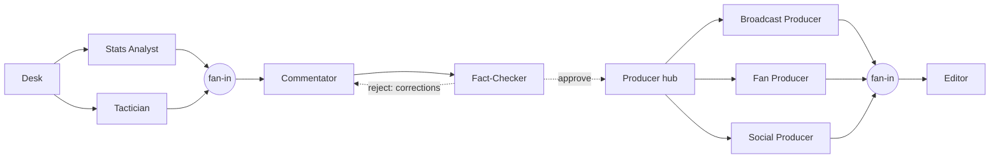

# ⚽ Touchline: an AI match-intelligence desk

**Touchline turns a synthetic football event stream into explainable match intelligence.** A crew of specialist AI agents, orchestrated with **Microsoft Agent Framework**, analyses every pass, shot, press and momentum swing. The crew writes live commentary, a tactical breakdown, a broadcaster brief, a personalised fan recap and social posts. A **Fact-Checker agent** verifies every number against the data before anything is published.

> Built for *Inside the Game: Developer Hackathon* (Microsoft × Premier League). All clubs, players and matches are fictional and synthetic.

---

## The problem
Broadcasters, studios and fan apps need match stories *fast*: live lines, studio talking points, recaps, social posts. Each audience needs a different cut. LLMs can write that quickly, but they **make up numbers**. In sport a wrong stat is a credibility problem. Touchline makes AI match narration **trustworthy**:

* **Explainable.** Every claim cites a fact (`[F12]`). Every fact links to the event ids it was computed from. Every turning point shows *what happened, why it mattered* (win-probability swing, counterfactual) *and the evidence* (the move, drawn on a pitch).
* **Verified.** A deterministic verifier and a Fact-Checker agent reject drafts with wrong numbers, impossible scorelines or unbacked stats. The draft goes back to the Commentator until it passes.
* **Personalised.** One verified package becomes outputs for the studio, for a fan of either club (beginner or expert, in 7 languages) and for social.
* **Resilient.** Timeouts, retries, provider failover and template fallbacks mean the desk never goes blank on matchday.

## What's inside

| Layer | What it does |
|---|---|
| **Synthetic match engine** (`touchline/sim`) | A seeded possession-chain simulator. It emits a full ~2,200-event match: passes, carries, shots with xG, tackles, interceptions, fouls, cards, corners, throw-ins and subs, all with x/y coordinates and timestamps. Six fictional clubs have distinct styles (high press, direct, counter-attacking, low block…). It's calibrated by **tests** against real-world per-match ranges: goals, shots, pass completion, xG≈goals, fouls, corners. |
| **Explainable analytics** (`touchline/analytics`) | Expected Threat (xT) for every action; a **live win-probability model** (Poisson, xG-updated rates, game state, red cards); **turning points ranked by win-probability impact**, including counterfactuals ("had it gone in: +23 pts"); momentum spells; pressing (PPDA, high regains); counters; attacking channels; player ratings; a storyline finder. |
| **Fact store** (`MatchStore`) | Every number becomes a citable fact (`F1…F150`) with label, value, unit and evidence event ids. `verify(text)` checks each citation's number, every scoreline and every uncited number. |
| **Agent crew** (`touchline/agents`) | 8 agents in a **Microsoft Agent Framework workflow** (below), with function tools over the fact store, a shared blackboard, and a full trace. |
| **Studio UI** (`app.py`) | Streamlit. Tabs: **Live** replay (win prob, momentum, commentary feed, shot map), **Intelligence** (turning-point cards with evidence), **Studio** (audience outputs with hoverable citations), **Agent trace** (timeline, AF workflow graph, Fact-Checker verdicts), **Ask the match** (grounded Q&A) and **Synthetic data** (calibration + CSV download). |

## Multi-agent orchestration (Microsoft Agent Framework)



The graph is built with `WorkflowBuilder` (`add_fan_out_edges`, `add_fan_in_edges`, conditional `add_edge`). The UI renders it straight from `WorkflowViz`.

| Agent | Role | Tools |
|---|---|---|
| **Stats Analyst** | 5 non-obvious, cited insights | `get_player_ratings`, `get_events(window)` |
| **Tactician** | styles, pressing, channels, *why momentum shifted* | `get_team_report`, `get_momentum` |
| **Commentator** | a live line for every turning point + match report | (works from the analysts' notes) |
| **Fact-Checker** | deterministic verification + an LLM review for qualitative claims; **sends drafts back with a correction list** (max 2 loops), then strips anything still unsupported | `lookup_fact` |
| **Broadcast / Fan / Social Producers** | run in parallel on the *approved* package, one per audience; the Fan Producer is persona-aware (club, expertise, language) | — |
| **Editor** | re-verifies every output, removes unsupported sentences or falls back to a grounded template, then publishes | — |
| **Match Q&A** | answers free-form questions with all tools; answers are fact-checked | all |

**Failure recovery** (try the sidebar toggles):
- every agent call has a timeout and a retry;
- providers fail over **GitHub Models → Azure AI Foundry → Ollama (local) → deterministic templates**;
- *Simulate outage* switches a provider off live, and the trace shows the hand-off;
- *Inject a wrong number* corrupts the Commentator's draft, and the Fact-Checker catches it and drives the revision.

Responses are cached on disk, so demos replay instantly and stay inside free-tier limits.

## Microsoft technologies
- **Microsoft Agent Framework** (`agent-framework-core`, `agent-framework-openai`): agents, function tools, and the workflow graph with fan-out/fan-in and conditional loops. `WorkflowViz` exports the graph.
- **GitHub Models**: free, Microsoft-hosted model inference (`openai/gpt-4.1-mini`) through the OpenAI-compatible endpoint.
- **Azure AI Foundry**: a drop-in provider (`AZURE_AI_ENDPOINT`/`AZURE_AI_KEY`, OpenAI v1 endpoint) for production.
- **Azure Container Apps–ready**: the `Dockerfile` runs the app on port 8501 (`az containerapp up --source .`).
- **GitHub Copilot / VS Code**: the development environment.

## Run it
```bash
python -m venv .venv && source .venv/bin/activate
pip install -r requirements.txt
cp .env.example .env            # optional: add GITHUB_TOKEN for GitHub Models
streamlit run app.py
```
No keys? It still works. The demo matches ship with precomputed crew runs in `cache/`. New runs use local Ollama if it's running (`ollama pull qwen2.5:7b`), otherwise the offline templates.

```bash
pytest -q                        # engine calibration + verifier tests
python scripts/build_demo.py     # storyline finder: pick dramatic matches, precompute crew runs
```

## Data statement
All match data is **synthetic**, generated by `touchline/sim/engine.py`. Clubs, players and names are invented. The engine's realism comes from *zone-level priors*: per-zone shoot/move/turnover and conversion rates on an 18×12 grid. Those are aggregate rates estimated from **StatsBomb Open Data** (free, public; thank you, StatsBomb) by an earlier Expected Threat project. No real match, event, player or club is reproduced or redistributed.

## Project structure
```
app.py                      Streamlit studio UI
touchline/sim/              synthetic match engine + fictional clubs
touchline/analytics/        xT, win probability, turning points, MatchStore (facts + verifier)
touchline/agents/           Agent Framework crew, tools, prompts, provider chain, templates
touchline/viz.py            Plotly figures (validated colour-blind-safe palette)
scripts/build_demo.py       storyline finder + demo precompute
tests/                      calibration + verifier tests
```
